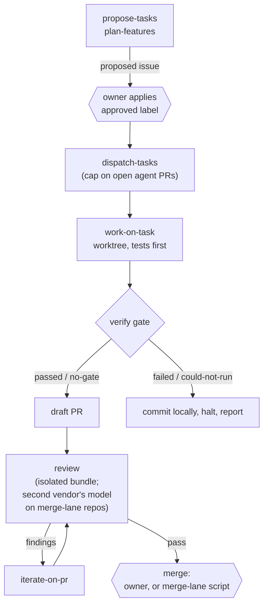

# agentic-pipeline

An autonomous development pipeline built on Claude Code skills (the `agentic-skills` plugin). A human approves an issue; an agent
implements it in a git worktree, runs the repo's own verify gate and opens a draft pull request; a
reviewer that did not write the code reviews it; a worker answers the findings. A macOS launchd
runtime fires the whole loop on a schedule, with no human at the keyboard.

It has run on a schedule since May 2026 on one always-on Mac, across a personal portfolio of repos.
The pilot it drives hardest today is StarBonk, a Unity game.

## The flow



Three rules hold the loop together:

- **A human decides what gets built.** An agent acts only on an issue that carries the `approved`
  label. The owner applies it, or a standing rule does for issues cut from the owner's written plan.
- **The repo decides what "done" means.** Each repo's `CLAUDE.md` names one verify command. The
  agent runs it and reports one of four outcomes; it never edits a test to make it pass.
- **No unattended run can merge.** `gh pr merge` and `gh pr ready` are denied to every headless run
  ([`headless-deny.sh`](./launchd-runtime/bin/headless-deny.sh)). In an interactive session the
  agent merges only on the owner's explicit instruction.

## Results

A "decided" PR or proposal is one that has been closed one way or the other; the open backlog is
not counted.

| Figure | Value | As of | Source |
|---|---|---|---|
| Decided agent PRs that were merged | 73 of 75 (97.3%) | 2026-11-11 | `make funnel` |
| The same figure at the first assessment | 36 of 37 (97.3%) | 2026-07-14 | [assessment](./docs/assessments/2026-07-14-skill-efficiency-assessment.md) |
| Decided proposals that the owner approved | 115 of 150 (76.7%) | 2026-11-11 | `make funnel` |
| Cost per merged PR, all routines included | $8.36 ($83.63 over 10 PRs in 30 days) | 2026-07-14 | assessment, `make cost` |
| Reviewed agent PRs that passed every review first time, pilot repo | 4 of 16 | 2026-11-12 | `make review-rollup` |
| Regression tests | 492, hermetic, no network | 2026-11-13 | `make test` |

The July assessment gives its own caveat: the sample is small, and the numbers are a baseline for a
trend, not a verdict. The cost figure has not been re-measured since.

## How it is verified

- **Acceptance criteria.** Every issue states what "done" means before an agent starts.
  [`work-on-task`](./skills/work-on-task/) refuses an issue that is closed, not approved, blocked
  by an open dependency, or in a repo with no `CLAUDE.md`.
- **Tests first.** The worker writes tests that encode the acceptance criteria before any
  implementation, and checks that they fail on the missing behaviour. A change no test can express
  says so in the PR body.
- **A gate with four outcomes.** `passed`, `no-gate`, `failed`, `could-not-run`. Only the first two
  open a PR; the other two commit locally, halt and report.
- **Stopping conditions.** A worker gets two retries on a failing gate, then stops. A review lane
  gets at most three rounds, and the last round may raise no new finding (`REVIEW_ROUND_MAX` in
  [`repos.conf.example`](./launchd-runtime/repos.conf.example)). When the rounds run out, the
  pipeline asks the owner for the merge. Each run has a spend cap and a wall-clock watchdog.
- **A reviewer that is not the author.** Every review reads an isolated bundle that leaves out the
  author's framing. For merge-lane repos and for changes to the pipeline itself,
  [`cursor-review`](./launchd-runtime/bin/cursor-review) hands that bundle to a non-Anthropic model
  through the Cursor CLI and refuses to run with a Claude model, so that Claude is not reviewing
  Claude. Other repos get [`review-pr`](./skills/review-pr/). In its first two rounds on its own
  code the Cursor lane raised six findings; all six were valid
  ([assessment](./docs/assessments/2026-09-08-cursor-review-lane.md)).
- **An eval for the reviewer.** [`tests/evals/review-pr/`](./launchd-runtime/tests/evals/review-pr/)
  plants a one-character boundary bug that the repo's own tests pass, then measures whether the
  reviewer catches it and whether it invents findings on the clean case.
- **A deny-net.** Every headless run carries the deny rules in
  [`headless-deny.sh`](./launchd-runtime/bin/headless-deny.sh), on top of the shared baseline in
  [`permissions/`](./permissions/README.md) and a hook that protects named paths from deletion.

## Observability

Every scheduled routine runs with JSON capture on, so a run that gets past its pre-flight checks
leaves rows behind, and the evening digest reads them back.

| What is recorded | Where | Read by |
|---|---|---|
| One row per routine run: exit code, duration, cost, or the reason it skipped | `runs.jsonl` | `make cost` |
| Every completed tool call: the tool, how long it took, a short label (never its output) | `tool-calls.jsonl`, from a `PostToolUse` hook | `make trace` |
| Failed tool calls | `tool-failures.jsonl`, from a `PostToolUseFailure` hook | `make trace`, the friction line |
| Each command the deny-net refused | `denials.jsonl` | the friction line |
| Every Telegram message sent through the sender | `sends.jsonl` | `routine-cost --sends` |
| Review rounds, verdicts and findings | markers on the pull request itself | `make review-rollup`, the review line |
| Proposals, approvals, PRs and merges, with time to approval | GitHub itself | `make funnel` |

`make trace ROUTINE=<name>` prints that routine's last run as a timeline. This one is a test run
through the real runner, with a forked skill in the middle:

```
done at   waited        tool             took  what
11:18:05                Bash             0.2s  echo outer-one
11:18:08      3s        Bash             0.0s  echo inner-ran
11:18:09      0s        Skill            2.8s  inner-probe
11:18:10      1s        Bash             0.0s  echo outer-two

4 steps, 0 failed: 3.0s inside tools, 4.0s waited between them
```

**Friction is a measured thing, not an impression.** The same denial or the same failed call in two
or more distinct runs within seven days becomes one `Friction:` line in the evening digest. The
digest also carries a `Review:` line: of the agent PRs opened this week, how many passed every
review, the median rounds, how many used every round, and any that merged on a commit no reviewer
passed. The lines put the repeat in front of the owner, who decides what it means.

The ledgers cover headless runs; of an interactive session only its Telegram sends are recorded.
Spend is recorded per routine, so cost per merged PR is a division over a window, not a per-PR
measurement.

## Where it failed, and what changed

| When | What happened | What changed |
|---|---|---|
| 2026-05-10 | One dispatch run lasted 8.9 hours. | Every routine now has a spend cap (`--max-budget-usd`) and a wall-clock watchdog that kills the run and sends a Telegram. |
| 2026-06-24 | The CLI login expired. Every run failed in seconds with a 401 for two days: 10 lost runs and 10 identical alerts that gave no guidance. | A long-lived token, plus a pre-flight canary that aborts the run and sends one de-duplicated, actionable alert. |
| 2026-09-02 | Dispatch deadlocked. The cap counted approved-but-unstarted issues, so the queue was weighed against the only gate that could drain it. | The cap counts open agent PRs only, lives in one file, and prints one `DISPATCH GATE:` line per run. |
| 2026-09 (week 37) | All 55 scheduled runs exited 0, and one pull request came out. The pipeline was reliable and almost idle. | The [audit](./docs/assessments/2026-09-13-week-37-pipeline-audit.md) named what the pipeline was waiting on. Spend is now recorded for every routine; it was two of nine. |
| 2026-09 | Author, reviewer and gate were the same model on the same account. | The Cursor review lane above. |
| 2026-11-12 | The digest's skill listed three ledger commands and the model ran one. Two lines were missing with nothing to say why. | The step-level trace showed it the next morning. The step is now one command. |

Each past bug class is encoded as a permanent test.

## The skills

Each skill is a self-contained `skills/<name>/SKILL.md`, invoked as `/<name>`. What a `SKILL.md`
must contain is written down in [`docs/skill-standard.md`](./docs/skill-standard.md), and the
mechanical part is checked by a static test. All of them inherit one set of behavioural rules,
[`BASELINE.md`](./BASELINE.md), instead of restating it.

**Core loop**

| Skill | What it does | Runs |
|---|---|---|
| [`propose-tasks`](./skills/propose-tasks/) | Surveys a repo with no human-led direction and cuts at most two `proposed` chore issues. | scheduled |
| [`plan-features`](./skills/plan-features/) | The design conversation for one repo: reviews what shipped, updates the direction documents with the owner, cuts the week's issues. | interactive |
| [`dispatch-tasks`](./skills/dispatch-tasks/) | Sends `approved` issues to `work-on-task` one at a time, bounded by how many agent PRs already await review. | scheduled |
| [`work-on-task`](./skills/work-on-task/) | Implements one approved issue in a worktree, runs the verify gate, opens a draft PR. | called by dispatch |
| [`review-pr`](./skills/review-pr/) | Reviews one PR against the issue's acceptance criteria and the real gate; posts inline threads and a machine-readable verdict. | scheduled |
| [`iterate-on-pr`](./skills/iterate-on-pr/) | Answers open review feedback with commits, one reply per thread and one summary comment. | scheduled |

**Human gates**

| Skill | What it does | Runs |
|---|---|---|
| [`request-approval`](./skills/request-approval/) | Creates the issue a human must sign off, sends a Telegram, and stops the run. | called by other skills |
| [`unstick`](./skills/unstick/) | The daily review sitting: lists everything waiting on the owner, most-unblocking first, and acts only on an explicit yes per item. | interactive |
| [`notify`](./skills/notify/) | Owns the one Telegram send recipe and its ledger. | called by other skills |

**Operations**

| Skill | What it does | Runs |
|---|---|---|
| [`triage-repo`](./skills/triage-repo/) | Classifies one repo's open issues and PRs into fixed urgency buckets. Read-only. | called by triage |
| [`morning-triage`](./skills/morning-triage/) | Scans the active repos, escalates stalled blockers, sends one digest or nothing on a quiet day. | scheduled |
| [`daily-summary`](./skills/daily-summary/) | Evening digest: what shipped, what waits on the owner, whether the queue is moving, and the spend, friction and review lines. | scheduled |
| [`skill-assess`](./skills/skill-assess/) | Weekly audit of this repo's own skills for drift and breakage. | scheduled |
| [`use-machine`](./skills/use-machine/) | Puts a job on the right machine, waking a GPU or Windows box when the job needs it. | called by other skills |

**Domain extras**

| Skill | What it does | Runs |
|---|---|---|
| [`art-director`](./skills/art-director/) | Reviews visual work against a project's art bible, citing a rule and pixel evidence. | interactive |
| [`vfx-specialist`](./skills/vfx-specialist/) | Authors particle systems and shaders in Unity through a live-editor loop. | interactive |

## The schedule

One LaunchAgent per routine. Times are local to the pipeline host.

```
04:00  wake-status-digest     health check of yesterday's routines
04:02  morning-triage         classify open work across the active repos
04:05  morning-proposals      chore proposals, capped per repo and overall
04:10  dispatch-tasks-night   approved issues become draft PRs
04:20  skill-assess-weekly    Mondays: audit this repo's own skills
05:00  pr-review-night        review of open agent PRs (second vendor's model on merge-lane repos)
06:05  pr-iterate-night       workers answer the review findings
07:00  merge-lane-night       script merges PRs that pass fixed checks (opted-in repos only)
09:00  playtest-build-night   Mon/Wed/Fri: Mac and Windows game builds
18:05  daily-summary-routine  evening digest
19:00  daily-review-nudge     reminder of what waits on the owner
```

## Install

**The skills only**, as a Claude Code plugin — see
[`docs/plugin-distribution.md`](./docs/plugin-distribution.md):

```bash
claude plugin marketplace add amarcu/agentic-pipeline
claude plugin install agentic-skills@amarcu-skills
```

The plugin installs the skills and nothing else. Most of them read `launchd-runtime/repos.conf`
to learn where a repo is checked out and what the caps are, and that file is local to a machine,
so a checkout (below) is the tested way to run the pipeline. As a plugin alone, the skills that
need no roster work as they are: `triage-repo` was run that way against a public repository.

**The skills and the scheduled runtime**, from a checkout on macOS:

```bash
# 1. This machine's settings, from the tracked examples
cp launchd-runtime/repos.conf.example  launchd-runtime/repos.conf     # your repos, paths and caps
cp launchd-runtime/secrets.env.example launchd-runtime/secrets.env    # Telegram bot token and chat
chmod 600 launchd-runtime/secrets.env

# 2. Authenticate the CLI once, then link the skills and load the LaunchAgents
./launchd-runtime/bin/claude-cli /login
make install
make status          # did each routine fire?
```

`make install` schedules unattended runs: the routines start with permission prompts off, bounded
by the deny rules, the spend cap and the watchdog described above. Read
[`headless-deny.sh`](./launchd-runtime/bin/headless-deny.sh) before you run it. It links each skill into `~/.claude/skills/`, puts the CLIs and the routines' state
under `~/.agentic-skills/`, and renders one LaunchAgent per routine. `make install-dry-run` shows
every step first.

## Configuration

Nothing tracked names a machine, a network, a secret or a private project. Three local files hold
what is yours; each is git-ignored and has a tracked example beside it.

| Local file | Holds | Example |
|---|---|---|
| `launchd-runtime/repos.conf` | The repos the pipeline works on, where each is checked out, and every cap | [`repos.conf.example`](./launchd-runtime/repos.conf.example) |
| `launchd-runtime/secrets.env` | Telegram credentials and optional API keys. Parsed, never executed; ignored unless only its owner can read it | [`secrets.env.example`](./launchd-runtime/secrets.env.example) |
| `launchd-runtime/machines.conf` | Hosts and wake settings, only for [`use-machine`](./skills/use-machine/) | [`machines.conf.example`](./launchd-runtime/machines.conf.example) |

Two more conventions keep paths out of the code:

- A skill runs runtime scripts as `${CLAUDE_SKILL_DIR}/../../launchd-runtime/bin/...`, relative to
  its own folder, which works for a linked checkout and for an installed plugin alike.
- State lives under `~/.agentic-skills/`. Set `AGENTIC_SKILLS_HOME` to move it. The LaunchAgent
  plists are templates, and the installer fills in the absolute paths launchd requires.

A static test, [`test_no_personal_values.sh`](./launchd-runtime/tests/static/test_no_personal_values.sh),
fails the gate if a published file carries a home path, a MAC address, a private network address,
an e-mail address or a key.

## Repo layout

```
skills/<name>/          one folder per skill (16): SKILL.md, META.md, references/, scripts/
_templates/             skeleton for a new skill
BASELINE.md             behavioural rules every skill inherits
BASELINE-CODING.md      verify-gate rules, retry budget, when to stop and ask
launchd-runtime/        the scheduler
  agents/               one LaunchAgent template per routine
  prompts/              what each routine is told
  bin/                  the runner, the deny-net, the review lane, the metrics tools
  tests/                unit and static suites, mocks for gh, the CLI, Cursor and Telegram
  *.example             the three local config files
permissions/            deny and allow baseline, and the protected-paths hook
docs/                   skill standard, plugin distribution, dated assessments
tools/export-public.sh  builds and checks the tree that is safe to publish
.claude-plugin/         plugin and marketplace manifests
```

## Daily commands

```bash
make                  # list every target
make test             # the gate
make status           # last run of every routine
make trace            # runs with a step trace; ROUTINE=<name> prints the last one
make issues           # open issues and PRs across tracked repos
make funnel           # proposal, approval, PR and merge rates
make review-rollup    # review rounds, clean passes and findings per repo
make cost             # spend per routine, last 7 days
make doctor           # can this host build these projects?
```

Full reference: [`launchd-runtime/COMMANDS.md`](./launchd-runtime/COMMANDS.md). Architecture and the
launchd diagnostics: [`launchd-runtime/README.md`](./launchd-runtime/README.md).

## Safety model

1. **Per-repo `CLAUDE.md`** files state what an agent may do alone, what it must ask first, and what
   it may never touch.
2. **Deny rules outlive `--dangerously-skip-permissions`.** Deny rules still apply to a headless
   run. The shared baseline lives in [`permissions/`](./permissions/README.md). Deletion is allowed
   only for scratch, temp and regenerable paths; a command that matches no allow rule falls through
   to a prompt, not to permission. A hook resolves each command's real targets and refuses to
   delete a protected path, however the command is spelled.
3. **All PRs open as drafts, and no unattended run can merge.** For repos the owner has opted in,
   [`merge-lane`](./launchd-runtime/bin/merge-lane) is a script with no judgment of its own: it
   merges only when the second-model review passed on the exact head commit, the gate passed, every
   changed file is on an allowlist, and nobody requested changes. Everywhere else the owner merges.
4. **Approval gates.** `proposed` becomes `approved` by the owner's hand, or by a standing rule the
   owner wrote for issues cut from their own plan.
5. **Telegram on every failure.** The runner sends the last 30 lines of the log when a routine exits
   non-zero.

## About the history

This repository is published as a snapshot of a working repository. Issue and pull-request numbers
in the changelogs and assessments (`#35`, `PR #49`) refer to that repository's history, and the
names of other projects it has worked on are replaced by neutral ones (`acme/...`).

## Licence

MIT. See [`LICENSE`](./LICENSE).
